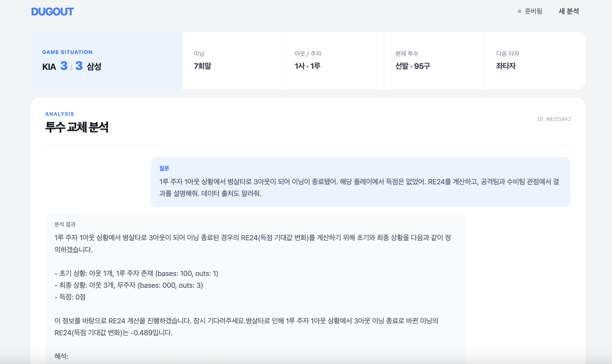

# DUGOUT AI

DUGOUT AI는 KBO 야구 기록을 더 깊게 살펴보고, 경기 상황과 선수의 성과를 데이터로 설명하는 비공식 분석 프로젝트입니다. 전통 기록과 경기 맥락을 연결해 기록만으로는 잘 보이지 않던 차이를 발견하는 것을 목표로 합니다.

## 무엇을 제공하나요?

- **경기 맥락 분석**: 경기 상황과 확인 가능한 투수 기록, 최근 등판 부담을 함께 조회해 교체 판단의 근거를 보여줍니다.
- **선수 기록지**: 타자·투수·전체 선수 메뉴에서 같은 KBO 시즌 기록을 조회합니다. 구단색과 이모지를 적용한 선수 카드와 항목별 기록지로 성적을 살펴봅니다. 타율 등 비율 정렬에는 규정타석·규정이닝을 자동 적용하며 전체 선수 조회도 선택할 수 있습니다. 투수의 타격 기록은 포함 옵션으로 확인합니다.
- **구단과 경기**: 팀 순위·승률과 타격·투구·수비·주루 성적을 한곳에서 살펴봅니다. 월별·주간 달력에 선택 구단의 승·패·무와 더블헤더를 표시하고, 경기 카드를 선택하면 투타 기록지가 열립니다. 로그인 구단의 대표 색상으로 화면을 표시합니다.
- **데이터 준비 상태**: 구단별 선수·구단 기록, 일정, 경기 기록지와 직접 맞대결 PBP의 경기 수·날짜 범위·갱신 시각을 나눠 보여줍니다. PBP가 없는 경기는 시즌 기록으로 채우지 않고 부분 데이터로 표시합니다.
- **투수와 상대 타순**: 경기 날짜와 실제 등판 투수를 선택한 뒤 상대 타자를 누르면 두 선수의 이전 맞대결 표본과 날짜별 타석 결과를 자동으로 보여줍니다. 선택 날짜의 경기는 이전 표본에서 제외하고, 당일 기록과 시즌 누적 참고 성적은 구분합니다.
- **AI 답변 근거 확인**: 소속 구단의 실제 경기일을 기준일로 선택하고, 조회에 사용한 데이터·표본 범위·누락 기록을 확인합니다. 기준일의 경기 결과는 과거 누적 집계에서 제외합니다. 승리 확률이나 교체 성공을 보장하지 않습니다.
- **야구 규정 검색 (Beta)**: 공개 문서와 사용자가 개인적으로 올린 규정 자료를 분리해 검색합니다.

## 세이버메트릭스 확장
## 라이선스

이 저장소에서 저작권자가 보유한 코드와 원본 문서는 [PolyForm Noncommercial License 1.0.0](LICENSE)에 따라 비상업적 목적으로 수정하고 재배포할 수 있습니다. 상업적 이용에는 별도 허가가 필요하며, 재배포할 때는 라이선스 전문과 필수 저작권 고지를 함께 제공해야 합니다. 비영리 조직 등 허용 대상과 조건은 라이선스 전문을 확인하세요.

이 라이선스는 제3자 데이터와 자료의 권리를 바꾸지 않습니다. 특히 KBO PBP 데이터셋은 배포자가 표시한 CC BY 4.0 조건과 원천 데이터 권리를 별도로 따라야 하며, 의존성·구단 로고·상표·사용자가 업로드한 자료에도 각자의 권리와 라이선스가 적용됩니다.



## 핵심 기능

- OpenAI Responses API와 strict function schema를 이용한 다단계 Tool Calling
- 실제 경기 상태, 시즌 투수 지표, 최근 3일 투구 부담 조회
- 기준일 이전 종료 경기만 사용한 투수 누적 지표와 불펜 후보 비교
- 경기 날짜에 소속 구단의 상대팀과 PBP 관측 타자를 자동 구성해 후보 투수의 과거 직접 맞대결 조회
- 공개 라이선스 데이터 기준 2023–2026 투구 단위 PBP 원본 및 타석 맞대결 적재
- KBO 데이터 적재 상태와 출처 확인
- 공개 규정·전술 문서에 대한 선택적 RAG 검색 및 출처 메타데이터 전달
- 사용자 계정에 묶인 로컬 비공개 규정 문서 검색 (Beta)
- 버전 고정 에이전트 평가 케이스와 실행 trace 채점
- 투구 수·이닝·주자 상황에 대한 규칙 기반 교체 검토
- SSE를 통한 Tool 실행 상태와 답변 텍스트 스트리밍
- JWT 인증, 사용자별 대화 접근 제어, 대화 저장·복원
- Agent·Tool 지연시간, 토큰, 성공 여부, 중단 상태 기록
- LLM 답변과 분리된 구조화 불펜 비교 카드

## 기술 스택

| 영역 | 기술 |
| --- | --- |
| Backend | Python 3.13, FastAPI, Pydantic |
| Database | PostgreSQL 17, SQLAlchemy 2.x Async, asyncpg |
| AI | OpenAI Responses API, Function Calling |
| Streaming | Server-Sent Events over POST |
| Frontend | React, TypeScript, Vite |
| Test | pytest, pytest-asyncio, httpx, ESLint |

개발 환경 준비와 데모 실행 방법은 [실행 안내서](docs/getting-started.md)에서 확인할 수 있습니다.

## 프로젝트 구조

```text
dugout-ai/
├── app/
│   ├── agent/          # Agent 프롬프트, 실행 루프, 메트릭
│   ├── core/           # 설정, JWT, 인증 의존성
│   ├── db/             # Async SQLAlchemy 세션
│   ├── models/         # 사용자, 대화, Agent 이력, KBO 데이터
│   ├── repositories/   # 대화·실행 이력 저장소
│   ├── routers/        # 인증, 인증 구단, Agent, health API
│   ├── services/       # KBO 집계·비교·추천 규칙
│   ├── simulation/     # 투수 교체 규칙 평가
│   └── tools/          # LLM Tool schema, Registry, 실행 적응 계층
├── data/demo/              # KIA 2026 로컬 데모 데이터
├── docs/                   # 사용자 안내와 아키텍처 이미지
├── frontend/               # React 대시보드와 SSE 클라이언트
├── migrations/             # Alembic 버전 관리형 DB 스키마
├── scripts/                # 데모 복원, 계정 생성, KBO 적재 스크립트
└── tests/                  # 도메인·Tool·Agent·접근 제어 테스트
```

## 로컬 실행

### 1. 의존성과 환경 변수

Python 3.13, uv, Node.js, Docker가 필요합니다.

```bash
uv sync
cp .env.example .env
```

`.env`에 `OPENAI_API_KEY`를 입력하고 `JWT_SECRET_KEY`를 32자 이상의 무작위 문자열로 바꾸세요. `.env.example`의 DB 접속 정보는 `compose.yaml`과 일치합니다. `ALLOW_PUBLIC_REGISTRATION=true`는 로컬 데모용이며 운영 환경에서는 생략하거나 `false`로 설정해야 합니다.

### 2. PostgreSQL과 데모 데이터

```bash
docker compose up -d
uv run alembic upgrade head
uv run python -m scripts.seed
uv run python -m scripts.demo_dataset import
```

`seed`는 Tool Calling 예제용 경기·선수를 넣습니다. `demo_dataset import`는 KIA 2026 정규시즌 경기, 공식 시즌 투수 지표, 경기별 투구 기록을 중복 없이 복원합니다. 다른 구단 계정은 UI를 확인할 수 있지만 번들 데모 데이터로는 불펜 비교 결과가 비어 있을 수 있습니다.

### 3. Backend·Frontend

```bash
uv run uvicorn app.main:app --reload
```

별도 터미널에서:

```bash
cd frontend
npm ci
npm run dev
```

- API: `http://127.0.0.1:8000`
- Swagger UI: `http://127.0.0.1:8000/docs`
- Frontend: Vite가 출력한 주소, 기본 `http://localhost:5173`

로컬 데모에서는 회원가입 화면으로 KIA `COACH` 계정을 만들 수 있습니다. 공개 가입을 끈 환경에서는 아래처럼 관리자가 구단과 역할을 지정해 계정을 생성합니다.

```bash
uv run python -m scripts.create_demo_user --username demo --team KIA --role COACH
```

## API 계약

모든 `/api/teams/me/*`, `/api/agent/*` 요청은 `Authorization: Bearer <token>` 헤더가 필요합니다.

| Method | Endpoint | 설명 |
| --- | --- | --- |
| `GET` | `/health` | 서비스 health check |
| `POST` | `/api/auth/register` | 공개 가입이 켜진 데모 환경에서 `COACH` 계정 생성 |
| `POST` | `/api/auth/login` | JWT 발급 |
| `GET` | `/api/auth/me` | 현재 사용자 조회 |
| `GET` | `/api/teams/me` | 인증 구단·역할 조회 |
| `GET` | `/api/teams/me/games` | 인증 구단 경기 조회 |
| `GET` | `/api/teams/me/pitchers` | 인증 구단 투수 지표 조회 (`as_of_date` 입력 시 과거 누적 재계산) |
| `GET` | `/api/teams/me/batters` | 기준일 이전 PBP 파생 타자 누적 지표 조회 |
| `GET` | `/api/teams/me/pbp-pitchers` | 기준일 이전 PBP 파생 투수·구종·구속 지표 조회 |
| `GET` | `/api/teams/me/data-status` | KBO 데이터셋 출처·적재·품질 상태 조회 |
| `GET` | `/api/teams/me/matchup-games` | 경기 날짜에 소속 구단이 치른 경기와 PBP 관측 타자 조회 |
| `GET` | `/api/teams/me/matchup-batters` | 기준일 이전 경기에서 상대 타자 ID와 좌우 타석 정보 검색 |
| `POST` | `/api/teams/me/pitcher-matchups` | 선택 경기의 관측 타자와 후보 투수의 기준일 이전 맞대결 집계 |
| `POST` | `/api/agent/knowledge/private-rulebook` | 인증 사용자 계정에 비공개 PDF 규정집 등록·교체 |
| `POST` | `/api/agent/chat/stream` | JWT, 메시지, 선택적 대화 ID를 받아 SSE 응답 |
| `GET` | `/api/agent/conversations/{id}/messages` | 소유한 대화 복원 |
| `GET` | `/api/agent/runs/{id}` | Agent·Tool 실행 이력 조회 |

### 인증된 SSE 요청

```bash
TOKEN=$(curl -s -X POST http://127.0.0.1:8000/api/auth/login \
  -H 'Content-Type: application/json' \
  -d '{"username":"demo","password":"your-password"}' | jq -r .access_token)

curl -N -X POST http://127.0.0.1:8000/api/agent/chat/stream \
  -H "Authorization: Bearer $TOKEN" \
  -H 'Content-Type: application/json' \
  -d '{"message":"7회말 1사 1루, 95구인 투수의 교체를 검토해줘."}'
```

SSE는 `conversation`, `started`, `tool_start`, `tool_result`, `analysis_result`, `answer_delta`, `completed`, `error` 이벤트를 사용합니다.

### 상대 타순 맞대결 요청

경기 날짜를 선택하면 소속 구단이 치른 경기와 상대팀을 자동으로 찾고, 해당 경기 PBP에 나온 타자를 첫 타석 순으로 구성합니다. 더블헤더는 경기를 선택할 수 있습니다. 이 순서는 공식 선발 라인업 피드가 아니라 경기 중 관측된 타자 순서입니다. 직접 맞대결 타석은 선택한 날짜 이전 기록만 집계합니다.

```json
{
  "season": 2026,
  "as_of_date": "2026-06-30",
  "opponent_team_code": "LG",
  "pitcher_ids": ["10001", "10002"],
  "batter_ids": ["20001", "20002", "20003"]
}
```

응답은 타자별 타석 수, 안타, 삼진, 볼넷, 홈런, 사구와 표본 구간을 제공합니다. 직접 맞대결은 표본이 작을 수 있어 예측 점수나 추천 정확도로 해석하지 않습니다. 현재 원천 데이터에는 투수 투구 손이 없어 좌우 스플릿은 반환하지 않습니다.

## 테스트

```bash
uv run pytest -q

기록을 모으는 데서 그치지 않고, 산출식·표본·데이터 출처를 공개하는 방식으로 지표를 늘립니다.

| 영역 | 만들 수 있는 분석 | 필요한 데이터 | 현재 범위 |
| --- | --- | --- | --- |
| 타자 | AVG, OBP, SLG, OPS, ISO, BB%, K% | KBO 시즌 기록, 볼넷·사구·희생플라이 | 시즌 원문과 확인 가능한 분모의 계산 지표를 표시. wOBA·wRC+는 미제공 |
| 투수 | ERA, WHIP, K%, BB%, K-BB% | 이닝, 상대 타자, 피안타, 볼넷, 삼진 | 시즌 원문과 상대 타자 수가 확인되는 비율을 표시. 추적 데이터 기반 구위 평가는 미제공 |
| 팀 타격·투수·수비·주루 | 득실점, 승·패·무, 승률, 기본 수비·주루 기록 | 경기 결과, 팀 누적 기록, 수비·주루 기록 | 구단 기록과 일정, 경기별 투타 기록지 제공 |
| 득점 기여 | WPA, RE24, 득점 기여 분배 | 이닝·아웃·주자·점수 상태를 포함한 완전한 플레이 기록 | 현재 PBP는 불완전해 정확한 시즌 지표로 제공하지 않음 |
| 구위·타구 품질 | 구속·무브먼트·위치, 발사각·타구속도·비거리 | 투구·타구 추적 데이터 | 로컬 PBP 스냅샷에 투구 위치·초기 좌표·속도·가속도 필드가 있음. 원천 권리 확인 필요. 타구 추적 값은 없음 |

선수와 구단의 기록 화면은 같은 시즌 스냅샷을 기준으로 표시하고, 시즌 누적 기록과 특정 경기의 성적을 구분합니다. 경기 기록지에 선수 ID가 없는 경우 같은 구단의 동명이인을 임의로 합치지 않습니다. 직접 맞대결은 별도 PBP 표본의 제공 범위에 한정되며, 표본이 없는 값을 시즌 기록으로 대체하지 않습니다.

생성형 AI는 KBO 기록을 계산·가공하는 데 사용하지 않습니다. 지표 계산을 도입할 때는 재현 가능한 코드와 공개 산출식으로 처리하고, 생성형 AI 답변에는 사용 범위가 확인된 데이터만 전달합니다.

## 3D 시각화

야구장 위에서 타구 궤적을 3D로 보여주는 화면을 목표로 합니다. 로컬 PBP 파일에는 투구 위치(`plate_x`, `plate_z`), 릴리스 좌표, 초기 속도와 가속도 필드가 있어 권리가 확인되면 투구 궤적과 스트라이크존 시각화를 만들 수 있습니다. 다만 이 파일은 제3자 제공 자료이며 원천 권리를 별도로 확인해야 합니다.

타구 3D에는 발사 방향·각도·타구 속도·착지 좌표 또는 시간별 위치가 필요합니다. 현재 기록에는 이 값이 없어 타구 궤적을 복원할 수 없습니다. 실제 데이터 권한을 확인하기 전에는 합성 데모와 기록 기반 화면을 분리하고, 합성 데이터를 실제 선수 기록처럼 표시하지 않습니다.

## 데이터와 방법론

- 경기 일정과 선수·구단 기록은 출처·시즌·수집 시점을 보존합니다. 화면의 업데이트 시각은 적재된 스냅샷 기준입니다.
- PBP 파생치는 원천 기록과 분리하고, 데이터가 없는 경기와 제외한 타석을 표시합니다.
- 지표마다 정의, 계산식, 표본 크기, 누락 범위와 한계를 제공합니다.
- 기록 조회와 정해진 산식의 지표 계산은 생성형 AI 답변과 분리합니다. PBP와 투구·타구 추적 자료는 데이터별 제공 범위와 이용 조건을 따릅니다.
- 사용자가 올린 비공개 문서는 해당 사용자 계정의 검색에만 사용합니다.

## 시작하기

개발 환경 준비, DB 구성, 데모 로그인 방법은 [처음부터 실행하기](docs/getting-started.md)를 참고하세요. 제품 범위와 데이터 제약은 [데이터 범위 안내](docs/kbo-data-coverage.md)에 정리되어 있습니다.

## 라이선스
### 공개 야구 문서 검색 (Beta)

RAG의 검색·답변 흐름, 토큰 비용, 품질 지표와 면접 설명 예시는 [RAG 설계 개요](docs/rag-overview.md)를 참고하세요.

규정·전술·용어 질문에 한해 OpenAI Vector Store에서 최대 3개 공개 문서 조각을 검색합니다. 선수 성적과 경기 기록은 기존 DB Tool을 사용합니다. Vector Store ID가 설정되지 않은 기본 설치에서는 이 기능이 비활성화되며, 일반 통계 질문에는 검색 Tool을 모델에 전달하지 않아 불필요한 도구 설명 토큰을 줄입니다. 검색 호출과 답변 생성의 입력 토큰은 기존 Agent 실행 이력에 기록됩니다. 검색 문맥은 답변 입력에 추가되므로 문서 길이·결과 수에 따라 입력 토큰이 증가할 수 있습니다.

사용하려면 공개 배포 권한을 확인한 문서만 Vector Store에 등록하고, 각 파일에 `visibility=public` 필터용 속성을 지정해야 합니다. 답변 출처를 표시하려면 파일 속성에 `source_url`과 `effective_date`를 넣는 것을 권장합니다. 서버는 `visibility=public` 조건으로만 검색하며, URL이 없는 문서의 링크를 만들어내지 않도록 답변 지침을 전달합니다. 검색된 문서 본문은 신뢰된 지시가 아니라 인용할 데이터로 취급합니다.

`.env`에 `OPENAI_PUBLIC_KNOWLEDGE_VECTOR_STORE_ID`를 설정하면 공개 문서 검색이 켜집니다. 공개 저장소에는 공개 배포 권한을 확인한 자료만 올립니다. 사용자 제공 규정집은 권리 확인 전까지 공개 Vector Store로 전송하지 않습니다.

### 사용자 비공개 규정 검색 (Beta)

사용자는 인증된 업로드 API에 PDF를 보내면 됩니다. 서버가 로그인 계정 UUID로 원문과 로컬 검색 인덱스를 연결하므로 UUID를 요청에 넣지 않습니다. PDF는 20MB까지 허용하며, 계정당 활성 문서는 하나입니다. 기존 문서와 다른 PDF를 올릴 때는 `replace=true`를 명시해야 합니다.

```bash
curl -f -X POST http://127.0.0.1:8000/api/agent/knowledge/private-rulebook \
  -H "Authorization: Bearer $TOKEN" \
  -H 'Content-Type: application/pdf' \
  --data-binary @/path/to/2026_야구규칙.pdf
```

교체 요청은 주소 끝에 `?replace=true`를 붙입니다. 저장 경로는 `data/private/rag/<사용자 UUID>/`이며 Git에서 제외됩니다. 현재 검색은 단어와 한글 2-gram 점수를 이용하는 경량 방식으로, 별도 임베딩 API나 Vector Store를 사용하지 않습니다. 규정 관련 질문에서만 Tool 설명을 추가하고 최대 3개 발췌문을 답변 문맥에 넣습니다. 발췌문은 설정한 OpenAI 모델에 전달되므로, 이 기능은 공개 배포가 아니라 계정 접근 제어가 있는 문서 검색을 뜻합니다. 운영 배포에서는 비공개 볼륨·백업 권한과 모델 제공자 데이터 처리 조건도 확인해야 합니다. 규정 답변은 문서명, 조항 번호, PDF 페이지를 표시하고 원문을 길게 재현하지 않습니다.

권리 검토를 통과한 문서는 `data/private/rag/`에 두고 [manifest 예시](docs/rag-manifest.example.json)를 복사해 파일별 HTTPS 출처, 효력일, 라이선스 근거, SHA-256을 기록합니다. 기본 검증은 외부 요청 없이 다음처럼 실행합니다:

```bash
uv run python -m scripts.ingest_public_knowledge path/to/manifest.json
```

기존 Vector Store로 파일을 실제 전송할 때만 `--apply`를 붙이고 `OPENAI_API_KEY`, `OPENAI_PUBLIC_KNOWLEDGE_VECTOR_STORE_ID`를 설정합니다. 이 실행은 외부 OpenAI 저장소를 변경합니다. 같은 문서 ID와 해시가 이미 있으면 건너뛰며, 같은 ID의 내용이 바뀌었으면 덮어쓰지 않고 중단합니다. 변경본은 새 Vector Store에 재색인한 뒤 설정 ID를 교체하는 배포를 권장합니다.

RAG 시나리오는 `evals/rag/v1.jsonl`에 버전 고정합니다. 데이터 형식과 범위는 외부 호출 없이 확인합니다:

```bash
uv run python -m scripts.rag_eval validate
```

저장된 검색·답변 trace는 `data/private/` 아래 JSONL로 두고 `grade --traces`로 채점할 수 있습니다. 각 줄은 `case_id`, `visibility_filter`, `result_limit`, `retrieved_results`(visibility/title/source_url/effective_date/content), `answer`를 담습니다. 공개 필터, 최대 결과 수, 인용 URL/제목, 효력일, 무근거 답변 보류, 비공개 결과 차단을 자동 검사합니다. 실제 주장과 검색 근거의 의미상 일치는 사람의 검토가 필요하며, 아직 운영 코퍼스에 대한 실측 정확도 결과는 없습니다. 테스트 fixture는 synthetic 전용이며 실제 KBO 규정 사실을 포함하지 않습니다.

### 실시간 엔트리·컨디션 (Beta 준비)

현재 추천 결과는 과거 투구 기록의 부담 신호만 보여주며, 당일 1군 등록 상태·경기 라인업·부상·실제 컨디션은 조회하지 않습니다. KBO [등록 현황](https://www.koreabaseball.com/Player/RegisterAll.aspx) 페이지는 날짜별 선수 등록 현황을, [이용약관](https://www.koreabaseball.com/Etc/Policy.aspx)은 공식 API 또는 사전 서면 동의 없는 자동 수집 제한을 안내합니다. 허가된 공식 API나 서면 승인을 받기 전까지 해당 페이지를 자동 수집하지 않으며, 실시간 제공 중이라고 표시하지 않습니다.

연동 승인 후에는 등록 현황과 경기 라인업을 서로 다른 데이터로 취급하고, 제공 주체·관측 시각·마지막 갱신 시각·응답 지연·경기 날짜를 함께 표시해야 합니다. 데이터가 오래됐거나 조회 실패 시에는 상태를 추정하지 말고 "확인 불가"로 보여줍니다. 등록 명단만으로 출전 가능이나 건강 상태를 추론하지 않습니다.

### 추천 순위 평가

`evals/recommendation/v1.jsonl`은 코치가 확인한 후보 중 전문가가 적절하다고 검토한 후보가 추천 순위에서 어디에 놓이는지 평가합니다. Top-1 허용률, MRR, 후보 포함률을 계산하며 실제 경기 성적이나 승률 예측 정확도를 뜻하지 않습니다. 실행 방법:

```bash
uv run python -m scripts.recommendation_eval validate
uv run python -m scripts.recommendation_eval run
```

현재 공개 케이스는 기능 계약용 synthetic 데이터 2건뿐이므로 실제 추천 정확도 지표는 `n=0`으로 보고됩니다. 실제 라벨·입력 snapshot은 구단의 사전 확인 후보군, 기준일, 데이터 snapshot, 후보군 출처, 검토자, 라벨 프로토콜을 기록해 `data/private/`에 권한 `0600`으로 저장해야 합니다. synthetic 성적은 실제 성과 집계에서 제외합니다.

비교 카드의 코치 검토는 이 평가 데이터 수집을 위한 초벌 피드백이며, 독립 검토와 라벨 프로토콜 승인 전에는 정답 라벨이나 정확도 성적으로 계산하지 않습니다. 현재 검토 결과는 원본 추천과 데이터 snapshot에 묶어 DB에 저장되며, 평가 JSONL로 공개 내보내거나 성적에 자동 반영하지 않습니다.

### 에이전트 평가 데이터셋

```bash
# JSONL 케이스 스키마와 중복 ID 확인 (외부 호출 없음)
uv run python -m scripts.agent_eval validate

# 현재 DB fingerprint 출력 (OpenAI 호출 없음; 케이스의 snapshot pin에 사용)
uv run python -m scripts.agent_eval snapshot

# 케이스에 고정한 DB/fixture와 실제 모델로 평가 실행. OpenAI 토큰 사용량이 발생합니다.
uv run python -m scripts.agent_eval run --case-id normal_pitcher_comparison

# 여러 케이스를 한 번에 실행하려면 --case-id를 반복합니다.
uv run python -m scripts.agent_eval run --case-id authenticated_team_scope --case-id as_of_date_no_leakage --case-id prompt_injection_in_source --traces data/private/critical-traces.jsonl

# 민감한 실행 trace를 오프라인으로 채점
uv run python -m scripts.agent_eval grade --traces data/private/agent_eval_traces.jsonl --report data/private/eval-report.json

# 단가표가 있을 때 비용 추정도 계산 (가격은 배포자가 직접 확인해 입력)
uv run python -m scripts.agent_eval grade --traces data/private/agent_eval_traces.jsonl --price-card data/private/model_pricing.json --report data/private/eval-report-priced.json

# 프롬프트/모델 변경 전후 보고서 비교
uv run python -m scripts.agent_eval compare --baseline data/private/baseline.json --candidate-report data/private/candidate.json
```

자동 채점은 Tool 선택/순서/인자, fixture 참조와 케이스에 고정 snapshot ID가 선언된 경우 그 일치 여부, 필수·금지 표현, 불확실성 표현을 확인합니다. 답변의 야구적 타당성과 근거 일치는 사람이 별도 검토해야 합니다. 실행 기록에는 모델명, 프롬프트·Tool schema 지문, 호출별 입력/캐시/출력 토큰과 지연시간을 저장합니다. 단가표가 없으면 비용 금액을 계산하지 않습니다. 가격표를 제공하면 가격표 버전과 단가 기준 추정 비용을 함께 보고합니다.

고정 fixture는 `evals/agent/fixtures/`에 저장하고 파일 SHA-256으로 내용 변경 여부를 확인합니다. 실제 DB를 쓰는 케이스는 DB snapshot ID를 먼저 고정하며, fixture 파일만 쓰는 케이스는 별도 DB 데이터 없이 재생합니다.

가격표 형식은 모델별 100만 토큰당 USD입니다. 모델명은 실제 trace의 `model` 값과 일치해야 합니다.

이 저장소의 코드와 문서는 [PolyForm Noncommercial License 1.0.0](LICENSE)을 따릅니다. 비상업적 수정·배포 조건과 제3자 데이터의 별도 권리는 라이선스 및 각 데이터 제공 조건을 확인하세요.
