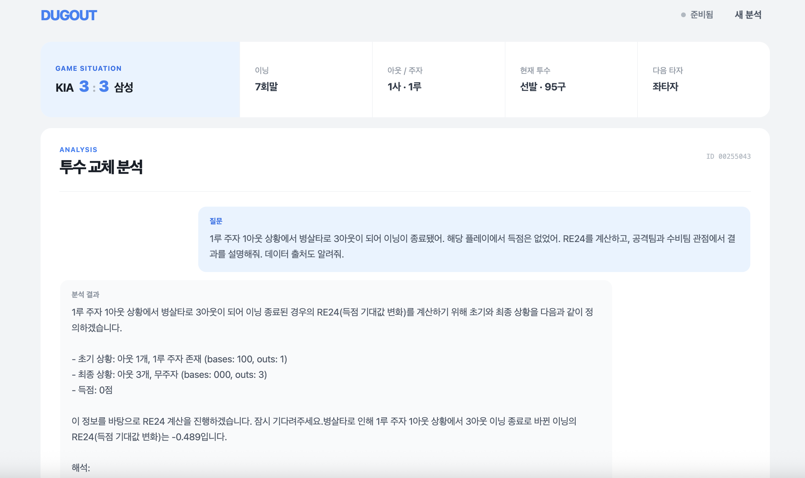

# DUGOUT AI

경기 중 투수 교체를 검토할 때 경기 상황, KBO 시즌 기록, 최근 투구 부담을 Tool Calling으로 조회하는 대화형 분석 서비스입니다. LLM이 수치를 만들지 않고 서버가 검증한 Tool 결과를 바탕으로 답변하는 구조에 초점을 맞췄습니다.

이 서비스는 교체 성공 확률이나 승률을 예측하지 않습니다. 확인된 데이터, 규칙 기반 판단, 현재 확인할 수 없는 정보를 구분해 제시합니다.

처음 프로젝트를 받은 분은 [DUGOUT AI 처음부터 실행하기](docs/getting-started.md)를 따라 하면 환경 준비부터 데모 확인, 전체 테스트까지 순서대로 실행할 수 있습니다.



## 핵심 기능

- OpenAI Responses API와 strict function schema를 이용한 다단계 Tool Calling
- 실제 경기 상태, 시즌 투수 지표, 최근 3일 투구 부담 조회
- 기준일 이전 종료 경기만 사용한 투수 누적 지표와 불펜 후보 비교
- 경기 날짜에 소속 구단의 상대팀과 PBP 관측 타자를 자동 구성해 후보 투수의 과거 직접 맞대결 조회
- KBO 데이터 적재 상태와 출처 확인
- 버전 고정 에이전트 평가 케이스와 실행 trace 채점
- 투구 수·이닝·주자 상황에 대한 규칙 기반 교체 검토
- SSE를 통한 Tool 실행 상태와 답변 텍스트 스트리밍
- JWT 인증, 사용자별 대화 접근 제어, 대화 저장·복원
- Agent·Tool 지연시간, 토큰, 성공 여부, 중단 상태 기록
- LLM 답변과 분리된 구조화 불펜 비교 카드

## 기술 스택

| 영역 | 기술 |
| --- | --- |
| Backend | Python 3.13, FastAPI, Pydantic |
| Database | PostgreSQL 17, SQLAlchemy 2.x Async, asyncpg |
| AI | OpenAI Responses API, Function Calling |
| Streaming | Server-Sent Events over POST |
| Frontend | React, TypeScript, Vite |
| Test | pytest, pytest-asyncio, httpx, ESLint |

개발 환경 준비와 데모 실행 방법은 [실행 안내서](docs/getting-started.md)에서 확인할 수 있습니다.

## 프로젝트 구조

```text
dugout-ai/
├── app/
│   ├── agent/          # Agent 프롬프트, 실행 루프, 메트릭
│   ├── core/           # 설정, JWT, 인증 의존성
│   ├── db/             # Async SQLAlchemy 세션
│   ├── models/         # 사용자, 대화, Agent 이력, KBO 데이터
│   ├── repositories/   # 대화·실행 이력 저장소
│   ├── routers/        # 인증, 인증 구단, Agent, health API
│   ├── services/       # KBO 집계·비교·추천 규칙
│   ├── simulation/     # 투수 교체 규칙 평가
│   └── tools/          # LLM Tool schema, Registry, 실행 적응 계층
├── data/demo/              # KIA 2026 로컬 데모 데이터
├── docs/                   # 사용자 안내와 아키텍처 이미지
├── frontend/               # React 대시보드와 SSE 클라이언트
├── migrations/             # Alembic 버전 관리형 DB 스키마
├── scripts/                # 데모 복원, 계정 생성, KBO 적재 스크립트
└── tests/                  # 도메인·Tool·Agent·접근 제어 테스트
```

## 로컬 실행

### 1. 의존성과 환경 변수

Python 3.13, uv, Node.js, Docker가 필요합니다.

```bash
uv sync
cp .env.example .env
```

`.env`에 `OPENAI_API_KEY`를 입력하고 `JWT_SECRET_KEY`를 32자 이상의 무작위 문자열로 바꾸세요. `.env.example`의 DB 접속 정보는 `compose.yaml`과 일치합니다. `ALLOW_PUBLIC_REGISTRATION=true`는 로컬 데모용이며 운영 환경에서는 생략하거나 `false`로 설정해야 합니다.

### 2. PostgreSQL과 데모 데이터

```bash
docker compose up -d
uv run alembic upgrade head
uv run python -m scripts.seed
uv run python -m scripts.demo_dataset import
```

`seed`는 Tool Calling 예제용 경기·선수를 넣습니다. `demo_dataset import`는 KIA 2026 정규시즌 경기, 공식 시즌 투수 지표, 경기별 투구 기록을 중복 없이 복원합니다. 다른 구단 계정은 UI를 확인할 수 있지만 번들 데모 데이터로는 불펜 비교 결과가 비어 있을 수 있습니다.

### 3. Backend·Frontend

```bash
uv run uvicorn app.main:app --reload
```

별도 터미널에서:

```bash
cd frontend
npm ci
npm run dev
```

- API: `http://127.0.0.1:8000`
- Swagger UI: `http://127.0.0.1:8000/docs`
- Frontend: Vite가 출력한 주소, 기본 `http://localhost:5173`

로컬 데모에서는 회원가입 화면으로 KIA `COACH` 계정을 만들 수 있습니다. 공개 가입을 끈 환경에서는 아래처럼 관리자가 구단과 역할을 지정해 계정을 생성합니다.

```bash
uv run python -m scripts.create_demo_user --username demo --team KIA --role COACH
```

## API 계약

모든 `/api/teams/me/*`, `/api/agent/*` 요청은 `Authorization: Bearer <token>` 헤더가 필요합니다.

| Method | Endpoint | 설명 |
| --- | --- | --- |
| `GET` | `/health` | 서비스 health check |
| `POST` | `/api/auth/register` | 공개 가입이 켜진 데모 환경에서 `COACH` 계정 생성 |
| `POST` | `/api/auth/login` | JWT 발급 |
| `GET` | `/api/auth/me` | 현재 사용자 조회 |
| `GET` | `/api/teams/me` | 인증 구단·역할 조회 |
| `GET` | `/api/teams/me/games` | 인증 구단 경기 조회 |
| `GET` | `/api/teams/me/pitchers` | 인증 구단 투수 지표 조회 (`as_of_date` 입력 시 과거 누적 재계산) |
| `GET` | `/api/teams/me/data-status` | KBO 데이터셋 출처·적재·품질 상태 조회 |
| `GET` | `/api/teams/me/matchup-games` | 경기 날짜에 소속 구단이 치른 경기와 PBP 관측 타자 조회 |
| `GET` | `/api/teams/me/matchup-batters` | 기준일 이전 경기에서 상대 타자 ID와 좌우 타석 정보 검색 |
| `POST` | `/api/teams/me/pitcher-matchups` | 선택 경기의 관측 타자와 후보 투수의 기준일 이전 맞대결 집계 |
| `POST` | `/api/agent/chat/stream` | JWT, 메시지, 선택적 대화 ID를 받아 SSE 응답 |
| `GET` | `/api/agent/conversations/{id}/messages` | 소유한 대화 복원 |
| `GET` | `/api/agent/runs/{id}` | Agent·Tool 실행 이력 조회 |

### 인증된 SSE 요청

```bash
TOKEN=$(curl -s -X POST http://127.0.0.1:8000/api/auth/login \
  -H 'Content-Type: application/json' \
  -d '{"username":"demo","password":"your-password"}' | jq -r .access_token)

curl -N -X POST http://127.0.0.1:8000/api/agent/chat/stream \
  -H "Authorization: Bearer $TOKEN" \
  -H 'Content-Type: application/json' \
  -d '{"message":"7회말 1사 1루, 95구인 투수의 교체를 검토해줘."}'
```

SSE는 `conversation`, `started`, `tool_start`, `tool_result`, `analysis_result`, `answer_delta`, `completed`, `error` 이벤트를 사용합니다.

### 상대 타순 맞대결 요청

경기 날짜를 선택하면 소속 구단이 치른 경기와 상대팀을 자동으로 찾고, 해당 경기 PBP에 나온 타자를 첫 타석 순으로 구성합니다. 더블헤더는 경기를 선택할 수 있습니다. 이 순서는 공식 선발 라인업 피드가 아니라 경기 중 관측된 타자 순서입니다. 직접 맞대결 타석은 선택한 날짜 이전 기록만 집계합니다.

```json
{
  "season": 2026,
  "as_of_date": "2026-06-30",
  "opponent_team_code": "LG",
  "pitcher_ids": ["10001", "10002"],
  "batter_ids": ["20001", "20002", "20003"]
}
```

응답은 타자별 타석 수, 안타, 삼진, 볼넷, 홈런, 사구와 표본 구간을 제공합니다. 직접 맞대결은 표본이 작을 수 있어 예측 점수나 추천 정확도로 해석하지 않습니다. 현재 원천 데이터에는 투수 투구 손이 없어 좌우 스플릿은 반환하지 않습니다.

## 테스트

```bash
uv run pytest -q

cd frontend
npm run lint
npm run build
```

기본 pytest는 외부 OpenAI 호출을 mock으로 대체하지만, FastAPI 요청을 통해 회원가입, JWT, SSE 이벤트, 대화 저장, Agent 실행 이력까지 연결하는 hermetic 통합 테스트를 포함합니다. 실제 PostgreSQL·OpenAI 연결까지 검증하려면 backend와 DB를 실행한 뒤 다음을 사용합니다.

```bash
RUN_E2E=1 uv run pytest tests/test_e2e_agent.py -v
```

E2E 테스트는 기본적으로 `dugout_e2e` 계정을 생성하고 JWT를 사용합니다. 필요하면 `E2E_USERNAME`, `E2E_PASSWORD`, `E2E_BASE_URL`을 지정할 수 있습니다. 실제 OpenAI API 비용이 발생합니다.

`ALLOW_PUBLIC_REGISTRATION=false`인 서버에서는 E2E 계정을 `scripts.create_demo_user`로 먼저 만들고 같은 자격 증명을 환경 변수로 전달해야 합니다. 이 테스트는 비용과 외부 서비스 의존성 때문에 기본 테스트 묶음에서는 명시적으로 제외됩니다.

## 스키마 변경

DB 스키마는 Alembic revision으로 관리합니다.

```bash
uv run alembic revision --autogenerate -m "변경 설명"
uv run alembic upgrade head
uv run alembic downgrade -1
```

이전에 `create_all()`로 만든 DB를 이어서 사용할 때는 현재 테이블이 초기 revision과 일치하는지 먼저 검증합니다. 일치하면 `uv run alembic stamp 20261101_0001`로 초기 revision만 표시한 뒤 `uv run alembic upgrade head`를 실행합니다. `stamp head`를 하면 새 migration이 건너뛰어질 수 있으므로 사용하지 마세요. 검증 없이 stamp하면 실제 스키마 차이가 숨겨질 수 있습니다.

## 데이터와 안전 범위

- 번들 데모는 KIA 2026 정규시즌 데이터이며 실시간 KBO 연동이 아닙니다.
- 타순 맞대결은 별도 PBP 데이터 적재가 필요합니다. 공개 데이터셋 snapshot을 가져오려면 `uv run python -m scripts.fetch_kbo_pbp_snapshot --season 2026 --output data/private/kbo_pbp_2026_hf.parquet`을 실행하세요. 고정된 저장소 revision, SHA-256, 날짜 범위, 원천/라이선스 표기를 `.source.json` sidecar에 기록하고 `data/private/` 아래에만 파일을 저장합니다. 다운로드만 수행하며 DB에는 반영하지 않습니다.
- 내려받은 파일을 먼저 dry-run 검증합니다: `uv run python -m scripts.import_kbo_plate_appearances data/private/kbo_pbp_2026_hf.parquet --season 2026 --source kbo_pbp_naver_sports_cc_by_4.0`. DB에 적재하려면 기존 DB 스키마와 migration 상태를 확인한 뒤 `--apply`를 추가합니다.
- PBP 데이터셋은 [배포자 저장소](https://github.com/slothman3878/kbo_pbp_naver_sports)와 [데이터 카드](https://huggingface.co/datasets/slothman3878/kbo_playbyplay)에 명시된 출처·라이선스를 확인해야 합니다. 배포자는 Naver Sports 중계 API 기반이며 데이터셋 라이선스를 CC BY 4.0으로 표시합니다. 서비스 운영 전에는 원천 데이터의 상업적 사용 및 재배포 권한도 확인해야 합니다.
- `as_of_date` 분석은 적재된 경기별 기록을 기준일 이전 종료 경기로 다시 집계합니다. 날짜 안의 경기 순서는 구분하지 않습니다.
- 평가 데이터셋은 `evals/agent/v1.jsonl`에 버전 고정합니다. 아래 `validate`와 `grade`는 로컬 검증이며 LLM을 호출하지 않습니다. `run`은 실제 DB와 OpenAI API를 사용하고 토큰 비용이 발생할 수 있습니다. 실행 trace에는 답변과 Tool 인자가 담길 수 있어 `data/private/`에만 저장합니다.
- 데이터의 출처와 적재 상태를 제공하지만, 이는 데이터의 정확성이나 최신성을 보증하지 않습니다.
- `TEAM_NAME_UNIQUE`는 구단과 이름을 기준으로 연결한 잠정 ID입니다. 동명이인이나 매핑 근거가 불충분하면 비교에서 제외합니다.
- `REVIEW_REQUIRED`는 최근 투구 부담을 추가 확인해야 한다는 신호이며 등판 불가 판정이 아닙니다.
- `NO_HIGH_LOAD_FLAG`는 조회한 기록에서 높은 부담 신호가 없다는 뜻이며 출전 가능을 보장하지 않습니다.
- 공개 가입은 기본값이 꺼져 있고, 켜더라도 클라이언트가 역할을 선택할 수 없으며 `COACH`만 생성됩니다. 다만 데모 가입에서는 구단을 직접 고르므로 운영 계정은 관리자 프로비저닝 또는 조직 초대 흐름이 필요합니다.
- 불펜 비교는 확인 가능한 데이터에 기반한 참고 정보이며, 교체 성공 확률이나 실제 컨디션을 예측하지 않습니다.
<<<<<<< HEAD
- 상대 타순 직접 맞대결은 과거 관측 요약이며 미래 타석 결과를 예측하지 않습니다. PBP 데이터가 없는 경기의 타자는 자동 구성할 수 없고, 원천 데이터 범위 밖 경기와 당일 경기 결과는 맞대결 집계에 반영하지 않습니다.
=======

### 에이전트 평가 데이터셋

```bash
# JSONL 케이스 스키마와 중복 ID 확인 (외부 호출 없음)
uv run python -m scripts.agent_eval validate

# 실제 DB와 모델로 선택한 케이스 실행. OpenAI 토큰 사용량이 발생합니다.
uv run python -m scripts.agent_eval run --case-id normal_pitcher_comparison

# 민감한 실행 trace를 오프라인으로 채점
uv run python -m scripts.agent_eval grade --traces data/private/agent_eval_traces.jsonl --report data/private/eval-report.json

# 단가표가 있을 때 비용 추정도 계산 (가격은 배포자가 직접 확인해 입력)
uv run python -m scripts.agent_eval grade --traces data/private/agent_eval_traces.jsonl --price-card data/private/model_pricing.json --report data/private/eval-report-priced.json

# 프롬프트/모델 변경 전후 보고서 비교
uv run python -m scripts.agent_eval compare --baseline data/private/baseline.json --candidate-report data/private/candidate.json
```

자동 채점은 Tool 선택/순서/인자, fixture 참조와 케이스에 고정 snapshot ID가 선언된 경우 그 일치 여부, 필수·금지 표현, 불확실성 표현을 확인합니다. 답변의 야구적 타당성과 근거 일치는 사람이 별도 검토해야 합니다. 실행 기록에는 모델명, 프롬프트·Tool schema 지문, 호출별 입력/캐시/출력 토큰과 지연시간을 저장합니다. 단가표가 없으면 비용 금액을 계산하지 않습니다. 가격표를 제공하면 가격표 버전과 단가 기준 추정 비용을 함께 보고합니다.

가격표 형식은 모델별 100만 토큰당 USD입니다. 모델명은 실제 trace의 `model` 값과 일치해야 합니다.

```json
{
  "version": "2026-11-11",
  "unit": "USD_PER_1M_TOKENS",
  "models": {
    "모델명": {
      "input_usd_per_million": "현재 입력 단가 숫자로 교체",
      "cached_input_usd_per_million": "현재 cached 단가 숫자로 교체",
      "output_usd_per_million": "현재 출력 단가 숫자로 교체"
    }
  }
}
```
>>>>>>> 7aa6153 (feat: 에이전트 평가 데이터셋과 토큰 계측 추가)
