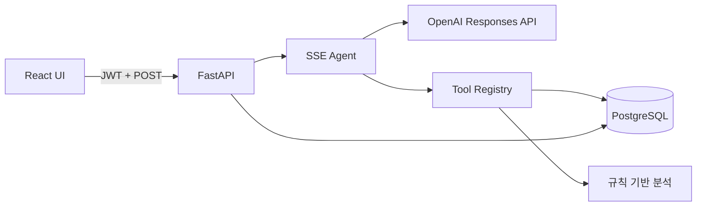
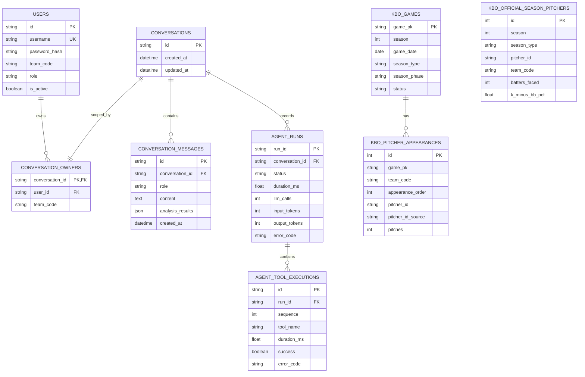

# DUGOUT AI 설계

## 문제 정의

경기 중 투수 교체 판단에는 경기 상황, 시즌 지표, 최근 투구 부담이 함께 필요하다. DUGOUT AI는 LLM이 답을 임의로 계산하는 대신, 서버가 제공하는 조회·계산 Tool을 선택하고 결과를 요약하도록 설계했다. 결과는 추천 확률이 아니라 확인된 지표와 한계를 구분한 의사결정 참고 자료다.

## 시스템 구조

- React는 `fetch` 스트림으로 SSE 이벤트를 읽고, Tool 진행 상태와 답변 delta를 별도로 표시한다.
- FastAPI는 JWT로 사용자를 확인하고 인증된 구단 코드를 Agent 문맥에 주입한다.
- LLM은 Tool 이름과 인자를 선택하지만 실행하지 않는다. Tool Registry가 allowlist, Pydantic 입력 검증, 권한 범위를 적용한다.
- 대화 본문, 구조화된 분석 결과, Agent·Tool 실행 이력은 PostgreSQL에 저장한다.

## Agent 실행 흐름

1. API가 대화 소유권을 확인하고 최근 20개 메시지를 불러온다.
2. 계획 단계는 `tool_choice=required`로 실행한다. 모델이 Tool을 선택하면 Registry가 입력과 권한을 검증한 뒤 실행한다.
3. Tool 결과를 `function_call_output`으로 모델에 반환하고, 분석이 끝나면 모델이 내부 제어 Tool인 `finalize_analysis`를 호출한다.
4. 계획 단계의 텍스트는 UI나 대화 문맥에 포함하지 않는다. 별도의 최종 단계에서 Tool을 금지하고 답변만 스트리밍하므로 중간 설명과 최종 답변이 섞이지 않는다.
5. 최대 5회 계획 라운드 후에는 강제로 최종 단계로 전환한다. Tool은 각각 10초 timeout을 적용한다.
6. 최종 답변 delta와 실제 Tool 상태만 SSE로 전송한다.
7. 정상 완료한 질문·답변만 하나의 교환으로 저장한다. 실행 감사 기록은 별도 DB 세션으로 유지한다.

## DB 스키마

`players`, `games`, `game_states`는 Tool Calling 예제와 규칙 기반 경기 상황 조회에 사용한다. 운영 UI와 불펜 비교는 공식 ID를 보존하는 `kbo_official_season_pitchers`, `kbo_pitcher_appearances`를 사용한다. `kbo_season_pitchers`, `kbo_pitching_appearances`는 원본 CSV 검증·집계 파이프라인의 중간 테이블로 분리했다. 중간 테이블까지 하나로 합치지 않아 출처와 식별 수준은 명확하지만, 중복된 시즌 지표를 동기화해야 하는 비용이 있다.

등판 기록과 경기의 `game_pk` 관계는 현재 논리적 관계이며 DB Foreign Key는 아니다. 원본 수집 순서와 구단 코드 표기 차이를 허용하는 대신 orphan 검출을 import/audit 단계에 의존한다. 운영 데이터 품질을 더 강하게 보장하려면 코드 정규화와 적재 순서를 고정한 뒤 FK로 승격해야 한다.

## 기술 선택과 trade-off

| 선택 | 장점 | 비용·제약 |
| --- | --- | --- |
| 계획/최종 응답 분리형 Tool Calling | Tool 라운드의 설명 텍스트가 최종 답변·저장 내용에 섞이지 않음 | 최종 답변을 위한 LLM 호출이 하나 더 필요해 지연시간과 비용이 증가 |
| SSE over POST | 텍스트·상태를 단방향으로 간단히 전송하고 JWT 헤더를 사용 | WebSocket의 양방향 제어가 없고, 프록시 timeout을 위한 heartbeat가 추가로 필요 |
| Async FastAPI + SQLAlchemy | LLM·DB I/O 대기 중 요청 처리 자원을 효율적으로 사용 | 취소·timeout 시 트랜잭션 rollback과 세션 수명 관리가 필요 |
| PostgreSQL + Alembic | JSON·관계 제약을 제공하고 revision 단위 배포·롤백이 가능 | 로컬 실행에 Docker가 필요하고 데이터 마이그레이션·downgrade 안전성은 revision마다 별도 검토 필요 |
| JWT bearer token | 서버 세션 없이 API와 SSE에 동일한 인증 방식 적용 | 현재 브라우저 `localStorage`에 저장하므로 운영 환경에서는 CSP·XSS 방어 또는 HttpOnly cookie 검토가 필요 |
| 규칙 기반 교체 신호 | 결과를 재현하고 기준과 한계를 설명하기 쉬움 | 승률·예상 실점 예측이 아니며 임계값은 실제 시즌 데이터로 검증되지 않음 |
| 최근 20개 메시지 문맥 | 입력 토큰과 비용의 상한을 단순하게 제어 | 긴 대화의 초기 사실이 유실될 수 있으며 요약 메모리는 아직 없음 |
| 실행 감사 DB 세션 분리 | Tool 트랜잭션 실패와 무관하게 Agent 상태를 남김 | 대화 생성과 감사 기록이 하나의 원자적 트랜잭션은 아니며 오픈 기록 복구 작업이 필요 |

## 알려진 제약

- 제공 데이터는 2026 스냅샷이며 실시간 엔트리·부상·컨디션을 확인하지 않는다.
- 공개 가입은 기본 비활성화이며, 활성화해도 `COACH` 역할만 발급한다. 다만 데모 가입에서는 구단을 직접 선택하므로 운영 환경은 관리자 프로비저닝이나 조직 초대 흐름이 필요하다.
- 초기 Alembic revision은 새 DB와 현재 모델을 기준으로 한다. 과거 `create_all()` DB는 스키마 일치 여부를 확인한 뒤 baseline stamp가 필요하다.
- 동일 대화에 대한 복수 동시 요청을 서버에서 직렬화하지 않는다.
- 모델별 Tool 선택·환각 회귀 평가셋은 추가 구축이 필요하다.
- 기본 CI 통합 테스트는 OpenAI를 대역으로 사용한다. 실제 모델·PostgreSQL 조합은 비용과 외부 의존성 때문에 `RUN_E2E=1`로 별도 실행한다.
