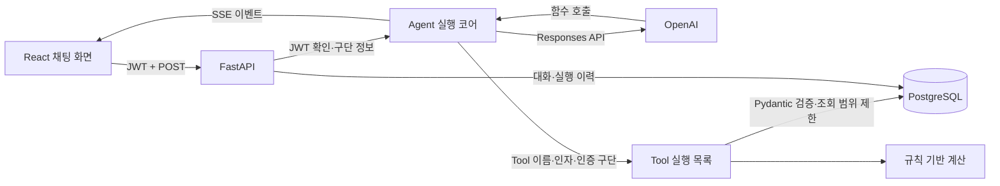
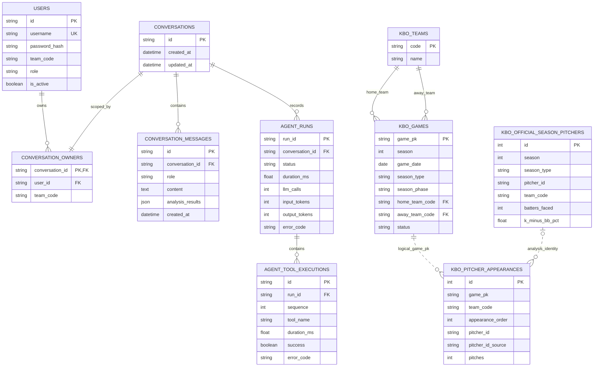
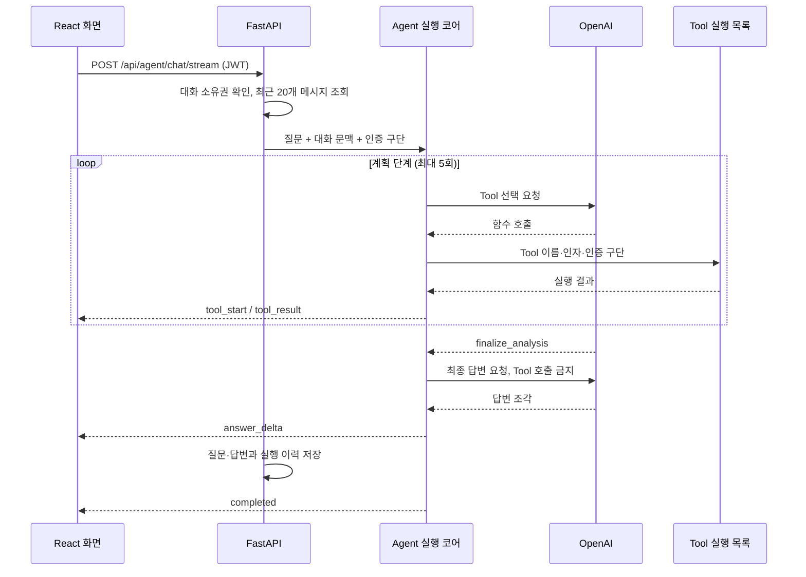

# DUGOUT AI 설계 문서

## 1. 문제 정의

경기 중 투수 교체 여부를 판단하려면 현재 경기 상황, 투수의 시즌 지표, 최근 등판에서 쌓인 투구 부담을 함께 봐야 합니다. 코치가 이 정보를 하나씩 찾아 비교하는 일을 Agent가 대신하고, 확인한 내용과 지금은 알 수 없는 내용을 나눠 보여주는 것이 DUGOUT AI의 목표입니다.

수치는 LLM이 계산하지 않습니다. 조회와 계산은 서버의 Tool이 맡고, LLM은 어떤 Tool을 어떤 순서로 호출할지 정한 뒤 결과를 설명합니다. 결과물은 교체 성공 확률이 아니라 의사결정 참고 자료입니다.

**주 사용자**

- 구단 코치를 대상으로 합니다. 공개 가입을 켠 데모 환경에서는 `COACH` 계정이 만들어지며, 로그인한 구단의 선수만 조회할 수 있습니다.

**다루는 범위**

- 경기 상황 조회
- 투수 시즌 지표와 최근 투구 부담 조회
- 규칙 기반 교체 신호 계산
- 불펜 후보 비교

**다루지 않는 범위**

- 승률·예상 실점 예측
- 부상이나 당일 컨디션 판단
- 인증된 구단 이외의 선수 조회

## 2. 도메인 선택 이유

투수 교체 판단에는 확인 순서가 있습니다. 경기 상태를 보고, 대상 선수를 식별하고, 시즌 기록과 최근 등판 기록을 조회한 뒤에야 비교할 수 있습니다. 앞 단계의 결과에 따라 다음에 호출할 Tool이 달라지므로 프롬프트 한 번으로 처리하기 어렵고, Tool을 단계적으로 호출하는 Agent 구조가 잘 맞습니다.

검증하기 쉽다는 점도 이유입니다. 통계 계산과 판단 규칙을 코드로 분리해 테스트할 수 있습니다. 데이터가 없는 항목은 답변에서 알 수 없다고 밝히면 됩니다.

## 3. 시스템 구성

| 구성 요소 | 역할 |
| --- | --- |
| React | `fetch` 스트림으로 SSE를 읽고 Tool 진행 상태와 답변 조각을 따로 표시합니다. |
| FastAPI | JWT로 사용자를 확인하고 인증된 구단 정보를 Agent에 전달합니다. 대화와 실행 이력도 저장합니다. |
| Agent 실행 코어 | OpenAI 호출과 Tool 호출 반복을 관리하고 SSE 이벤트를 만듭니다. |
| Tool 실행 목록 | 서버에 등록된 Tool만 실행합니다. Pydantic으로 입력을 검사하고 인증된 구단으로 조회 범위를 제한합니다. |
| 규칙 기반 계산 | 경기 상황과 투수 기록을 바탕으로 교체 검토 신호를 계산합니다. |
| PostgreSQL | KBO 데이터, 대화 본문, 구조화된 분석 결과, Agent·Tool 실행 이력을 저장합니다. |

### 권한 처리

LLM이 만든 `team` 값은 권한 판단에 쓰지 않습니다. 서버가 JWT에서 확인한 구단 코드를 Tool 인자에 넣고, 모델이 만든 구단 값이 있더라도 덮어씁니다. 예를 들어 KIA 계정 사용자가 다른 구단 투수를 요청해도 실제 선수 조회는 KIA 범위 안에서만 이뤄집니다.

### Agent가 사용할 수 있는 Tool

| 구분 | Tool | 역할 |
| --- | --- | --- |
| 경기·선수 | `get_game_state` | 저장된 경기 시점의 이닝, 아웃카운트, 투구 수를 조회합니다. |
| 경기·선수 | `get_pitcher_status` | 로그인한 구단 투수의 기본 정보를 조회합니다. |
| 경기·선수 | `get_bullpen_options` | 로그인한 구단의 다른 투수 목록을 조회합니다. |
| 규칙 계산 | `simulate_pitching_decision` | 이닝, 아웃카운트, 투구 수, 1루 주자 여부로 교체 검토 신호를 계산합니다. |
| 규칙 계산 | `calculate_re24` | 플레이 전후 주자·아웃 상황과 실제 득점으로 RE24를 계산합니다. |
| KBO 기록 | `search_season_pitchers` | 로그인한 구단에서 이름으로 투수를 찾고 ID를 확인합니다. |
| KBO 기록 | `compare_pitchers` | 로그인한 구단 투수 두 명의 시즌 지표를 비교합니다. |
| KBO 기록 | `get_bullpen_workload` | 최근 3일 투구 수와 연속 등판 기록을 조회합니다. |
| KBO 기록 | `compare_bullpen_candidates` | 시즌 지표와 최근 투구 부담으로 후보 1~5명을 비교합니다. |
| 실행 제어 | `finalize_analysis` | 정보 수집을 끝내고 최종 답변 단계로 넘어갑니다. 데이터는 조회하지 않습니다. |

## 4. API 설계

| 방식 | 주소 | 인증 | 역할 |
| --- | --- | --- | --- |
| `GET` | `/health` | 없음 | 서버 상태 확인 |
| `POST` | `/api/auth/register` | 없음 | 로컬 데모에서 `COACH` 계정 생성 |
| `POST` | `/api/auth/login` | 없음 | JWT 발급 |
| `GET` | `/api/auth/me` | JWT | 현재 사용자와 인증 구단 확인 |
| `GET` | `/api/teams/me/games` | JWT | 인증 구단의 시즌 경기 조회 |
| `GET` | `/api/teams/me/pitchers` | JWT | 인증 구단의 투수 기록 조회 |
| `POST` | `/api/agent/chat/stream` | JWT | Agent 실행 결과를 SSE로 전달 |
| `GET` | `/api/agent/conversations/{id}/messages` | JWT + 소유권 | 완료된 대화 복원 |
| `GET` | `/api/agent/runs/{id}` | JWT + 소유권 | Agent와 Tool 실행 이력 조회 |

### SSE 이벤트

`/api/agent/chat/stream`은 아래 이벤트를 보냅니다.

`conversation` → `started` → `tool_start` / `tool_result` 반복 → `answer_delta` 반복 → `completed`

불펜 후보 비교 결과가 있으면 `analysis_result`가 추가됩니다. 실행 중 문제가 생기면 `error`를 보냅니다. 사용자 질문과 최종 답변은 정상 완료됐을 때만 함께 저장합니다.

## 5. DB 구조

다이어그램에는 주요 컬럼만 표시했습니다.

### 테이블 구분

- 사용자·대화·실행 이력: `users`, `conversations`, `conversation_owners`, `conversation_messages`, `agent_runs`, `agent_tool_executions`
- 화면과 불펜 비교에 쓰는 KBO 데이터: `kbo_official_season_pitchers`, `kbo_pitcher_appearances`
- 원본 CSV 검증·집계용 중간 데이터: `kbo_season_pitchers`, `kbo_pitching_appearances`
- 규칙 기반 경기 상황 예제: `players`, `games`, `game_states` — 다이어그램에서는 생략했습니다.

중간 테이블을 운영 테이블과 합치지 않았습니다. 출처와 식별 수준이 분명해지는 대신, 중복된 시즌 지표를 함께 관리해야 합니다.

### 테이블 관계

`kbo_games.home_team_code`, `away_team_code`는 실제 외래 키이며 `kbo_teams.code`를 참조합니다. 점선으로 그린 두 관계는 DB 제약이 아니라 조회할 때 사용하는 연결 조건입니다.

- `kbo_games`와 등판 기록은 `game_pk`로 연결합니다.
- 공식 시즌 기록과 등판 기록은 `team_code + pitcher_id`로 연결합니다.

원본을 가져오는 순서와 구단 코드 표기 차이, 잠정 선수 ID를 허용하기 위해 이 두 관계에는 외래 키를 걸지 않았습니다. 부모 경기가 없는 기록과 선수 식별 충돌은 데이터 적재·점검 과정에서 찾습니다.

### 선수 ID 식별 수준

| `pitcher_id_source` | 의미 |
| --- | --- |
| `OFFICIAL_VERIFIED` | 공식 기록에서 선수 ID를 직접 확인한 경우 |
| `TEAM_NAME_UNIQUE` | 구단과 이름이 시즌 안에서 유일해 잠정 연결한 경우 |

식별 근거가 부족하거나 같은 경기·구단에서 동명이인이 확인된 선수는 연결하지 않고 비교에서도 제외합니다. 잠정 연결한 ID는 결과에 출처를 함께 표시합니다.

## 6. Agent 실행 순서

1. API가 대화 소유권을 확인하고 최근 메시지 20개를 불러옵니다.
2. 계획 단계에서는 모델이 반드시 Tool 또는 `finalize_analysis`를 고르게 합니다. 서버는 입력과 권한을 검사한 뒤 Tool을 실행하고 그 결과를 다시 모델에 전달합니다.
3. Tool 하나는 최대 10초까지만 실행합니다. 계획은 최대 5회 반복합니다.
4. `finalize_analysis`는 정보 수집이 끝났음을 알리는 내부 신호입니다. 데이터를 조회하지 않습니다. 모델이 이 신호를 내지 않아도 5회에 도달하면 서버가 최종 답변 단계로 넘어갑니다.
5. 최종 단계에서는 Tool 호출을 막고 답변만 생성합니다. 계획 단계에서 모델이 만든 설명 문장은 화면에 보내거나 대화에 저장하지 않습니다.
6. 정상 완료된 질문과 답변만 한 쌍으로 저장합니다. 실행 이력은 별도 DB 세션에 남겨 Tool 쪽 트랜잭션이 실패해도 확인할 수 있게 했습니다.

### 설계를 바꾸게 된 이유

**실행 경로 단일화.** 처음에는 일반 응답과 SSE 응답이 서로 다른 Agent 반복문을 썼습니다. 두 코드의 Tool 제한 시간, 최대 반복 횟수, 실행 시간 기록, 최종 답변 방식이 달라질 수 있어서 실제 화면이 쓰는 SSE 경로 하나로 합쳤습니다.

**계획과 최종 답변 분리.** 모델이 설명 문장과 함수 호출을 한 응답에 같이 만들면 중간 문장이 최종 답변에 섞였습니다. 그래서 계획 단계에서는 Tool 호출만 받고, 정보 수집이 끝난 뒤 별도 호출로 최종 답변을 만듭니다. 모델 호출이 한 번 늘어나지만 저장되는 답변이 무엇인지 분명해집니다.

## 7. 기술 선택 이유와 장단점

| 선택 | 선택한 이유 | 감수한 점 |
| --- | --- | --- |
| 계획과 최종 답변 분리 | Tool 실행 중 나온 설명이 최종 답변과 저장 내용에 섞이지 않습니다. | 최종 답변을 만들기 위한 모델 호출이 한 번 더 필요합니다. |
| POST 방식 SSE | 서버에서 화면으로 보내는 단방향 전송이면 충분하고 JWT 헤더를 그대로 쓸 수 있습니다. | 웹소켓처럼 양방향으로 제어할 수 없습니다. 프록시가 오래된 연결을 끊지 않도록 주기적인 신호가 필요합니다. |
| 비동기 FastAPI + SQLAlchemy | LLM과 DB 응답을 기다리는 동안 다른 요청을 처리할 수 있습니다. | 요청 취소나 제한 시간 초과 때 트랜잭션과 세션을 직접 정리해야 합니다. |
| PostgreSQL + Alembic | JSON 컬럼과 관계 제약을 쓸 수 있고, DB 변경을 버전별로 적용하거나 되돌릴 수 있습니다. | 로컬 실행에 Docker가 필요하고, 되돌리기가 안전한지는 DB 변경마다 확인해야 합니다. |
| JWT | API와 SSE에 같은 인증 방식을 쓸 수 있고 서버에 로그인 세션을 따로 저장하지 않아도 됩니다. | 현재 토큰을 브라우저 `localStorage`에 저장하므로 운영 환경에서는 스크립트 공격에 대한 방어 또는 HttpOnly 쿠키를 검토해야 합니다. |
| 규칙 기반 교체 신호 | 같은 입력에 같은 결과가 나오고 기준을 설명하기 쉽습니다. | 승률이나 예상 실점을 예측하지 않으며 임계값도 실제 시즌 데이터로 검증하지 않았습니다. |
| 최근 메시지 20개 사용 | 입력 토큰과 비용에 단순한 상한을 둘 수 있습니다. | 대화가 길어지면 앞부분의 정보가 빠집니다. 별도 요약 기능은 없습니다. |
| 실행 이력용 DB 세션 분리 | Tool 쪽 트랜잭션이 실패해도 Agent가 어디까지 실행됐는지 남길 수 있습니다. | 대화 저장과 실행 이력 저장이 하나의 트랜잭션은 아닙니다. 중간에 끝난 기록은 별도로 정리해야 합니다. |

## 8. 데이터 수집과 검증

2026년 KBO 정규시즌 기록을 수집하고 경기별 투수 등판 기록을 공식 박스스코어와 대조했습니다. 선수 이름, 등장 순서, 투구 수, 상대 타자 수, 볼넷, 탈삼진을 비교했습니다.

| 확인한 항목 | 결과 |
| --- | ---: |
| 종료 경기 | 720경기, 불일치 0건 |
| 경기별 투수 등판 기록 | 7,105건 |
| 공식 시즌 투수 기록 | 296명 |
| 구단·이름 기준 잠정 ID 연결 후보 | 6,952건 |
| ID 연결 보류 | 153건 |

공식 박스스코어가 선수 ID를 주지 않는 기록은 구단과 이름이 시즌 안에서 유일한지 확인해 잠정 연결하고, `pitcher_id_source=TEAM_NAME_UNIQUE`로 근거를 저장했습니다. 이 수치는 수집한 기록이 원본과 맞는지 확인한 결과이며, 투수 교체 추천이 얼마나 정확한지를 검증한 결과는 아닙니다.

## 9. 현재 범위와 한계

- 제공 데이터는 2026년 자료를 한 번 저장한 것이며 실시간 엔트리·부상·컨디션은 확인하지 않습니다.
- 과거 날짜의 최근 투구 부담과 2026시즌 전체 K-BB%를 함께 비교하면 해당 날짜 이후 기록도 포함됩니다. 당시 판단을 재현하려면 그 날짜까지 누적된 시즌 기록만 써야 합니다.
- 공개 가입은 기본적으로 꺼져 있습니다. 켜더라도 `COACH` 역할만 발급하지만 데모에서는 구단을 사용자가 직접 고릅니다. 운영 환경에는 관리자가 계정을 만들거나 초대하는 절차가 필요합니다.
- 초기 Alembic 버전은 새 DB와 현재 모델을 기준으로 만들었습니다. 예전 `create_all()` 방식으로 만든 DB를 이어서 쓸 때는 실제 스키마를 확인한 뒤 `alembic stamp head`를 한 번 실행해야 합니다.
- 같은 대화에 요청이 동시에 들어왔을 때 순서를 보장하는 장치는 없습니다.
- 모델 변경에 따른 Tool 선택과 답변 품질을 비교하는 회귀 평가 자료는 아직 없습니다.
- 기본 통합 테스트는 OpenAI를 대역으로 바꿔 실행합니다. 실제 모델과 PostgreSQL을 함께 쓰는 테스트는 비용과 외부 서비스 의존성 때문에 `RUN_E2E=1`일 때만 실행합니다.

## 10. 검증 결과

- **기본 테스트:** `95 passed, 1 skipped`입니다. 건너뛴 하나는 실제 OpenAI 호출이 필요한 테스트입니다.
- **HTTP 통합 테스트:** 회원가입 → JWT 인증 → SSE → 대화 저장 → 실행 이력 조회를 확인했습니다.
- **실제 전체 연동 테스트:** 2026-11-01 별도 PostgreSQL DB에 Alembic 스키마와 KIA 데모 데이터를 넣은 뒤 통과했습니다 (`1 passed in 11.05s`).
- **다단계 Tool 호출:** 실제 OpenAI Responses API에서 `get_game_state → simulate_pitching_decision` 순서로 실행됐습니다.
- **스트리밍과 대화:** OpenAI API 호출 4회, SSE 대화 2회, 문맥 복원, 메시지 저장, Agent·Tool 실행 이력을 확인했습니다.
- **KBO 후보 비교:** 추천 규칙, 선수 식별 정책, 구조화된 결과는 단위 테스트로 확인했습니다. 실제 외부 연동 테스트에는 `compare_bullpen_candidates`가 포함되지 않았습니다.
- **화면:** ESLint 검사와 배포용 빌드를 통과했습니다.

실제 전체 연동 테스트는 LLM, API, DB, SSE가 한 흐름으로 동작하는지 확인한 것입니다. 모든 Tool 조합이나 투수 교체 추천의 통계적 정확도를 검증한 것은 아닙니다.
